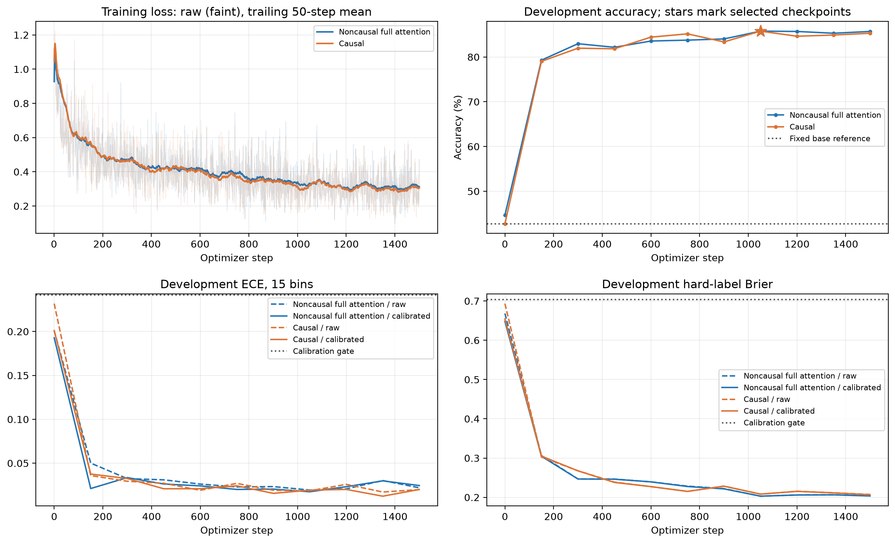
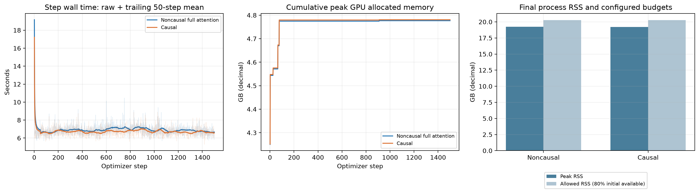
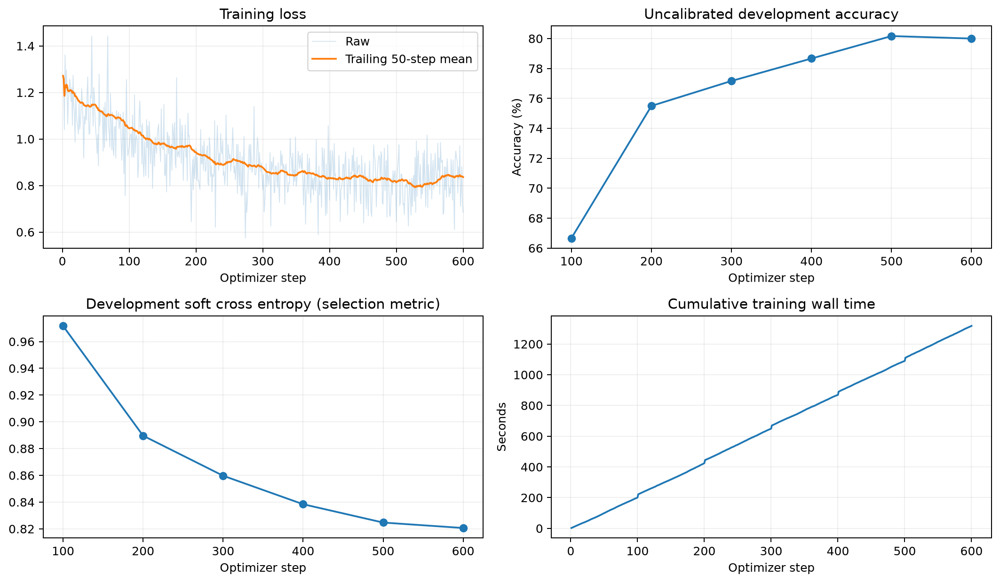

# 绘图代码和训练曲线

原有 `src/autojev/report.py` 是通用报告绘图模块。仓库现在还包含本次完整训练曲线的专用脚本，以及 AgentJev 的曲线脚本。以下命令均从仓库根目录运行，使用相对路径。

```bash
source .venv/bin/activate
pip install -r requirements-training.txt
```

## autojev 主组 / causal 对照

脚本：[plot_full_epoch.py](training/autojev/scripts/plot_full_epoch.py)。沿用原完整训练绘图逻辑，改为直接读取训练器与资源 wrapper 的输出，移除了本机目录和历史报告文件依赖。完成两组训练后执行：

```bash
python training/autojev/scripts/plot_full_epoch.py
```

默认读取 `training/autojev/` 下的这些文件：

- `runs/full-noncausal/run/{summary.json,training.jsonl,evaluations.jsonl}`
- `runs/full-causal/run/{summary.json,training.jsonl,evaluations.jsonl}`
- `logs/full-noncausal-resources.json`、`logs/full-causal-resources.json`
- `baselines/base-development.json`

生成 `training/autojev/plots/full-public/` 下的 `learning_and_calibration.{png,svg}`、`time_and_resources.{png,svg}` 和 `plot-manifest.json`。`--root` 可指定另一份训练工程，`--output` 可指定图片目录，`--baseline` 是相对于 root 的参照结果路径。例如读取原训练工程的日志：

```bash
python training/autojev/scripts/plot_full_epoch.py \
  --root ../jev-train/pplx_small \
  --baseline baselines/full-public/base-development.json \
  --output docs/plots/autojev
```

loss 和每步耗时的浅色线是原始记录，实线是向后最多 50 步的均值。dev accuracy 图中的星号表示选中 checkpoint。GPU 曲线是训练日志中的累计 `torch.cuda.max_memory_allocated`，不是瞬时显存，也不是全卡占用；RSS 来自资源 wrapper。dev 参与选优，这些图不代表独立 test 成绩。



[下载 SVG](docs/plots/autojev/learning_and_calibration.svg)



[下载 SVG](docs/plots/autojev/time_and_resources.svg)

通用报告也可单独生成：

```bash
PYTHONPATH=src python -m autojev.report \
  --events training/autojev/runs/full-noncausal/run/events.jsonl \
  --output training/autojev/plots/report
```

使用 [TRAINING.md](TRAINING.md) 中的 `AUTOJEV_EVENTS` 设置，将两组训练事件分别保存到对应 run 目录。

## AgentJev

脚本：[plot_training.py](agentjev_api/scripts/plot_training.py)。读取指定 run 的 `events.jsonl`，绘制 loss、未校准 dev accuracy、dev soft cross entropy 和累计训练耗时：

```bash
python agentjev_api/scripts/plot_training.py \
  --run-dir agentjev_api/runs/full_qwen3_0.6b
```

默认在该 run 的 `plots/` 中生成 `training_curves.png`、`training_curves.svg` 和 `plot-manifest.json`。用 `--output` 可另选目录；用另一个 `--run-dir` 可绘制 Base 版本或 smoke run。

图只使用 events 内实际记录的 dev 观测，不含单独保存的初始化报告；不会运行 test 推理。



[下载 SVG](docs/plots/agentjev/training_curves.svg)

## 验证

以上图片由真实已完成训练的日志重新生成并检查：autojev 主组/causal 各 1,500 步，AgentJev 为 600 步。没有重新训练模型。每个图片目录的 `plot-manifest.json` 记录输入来源及输出图片的 SHA-256；脚本不依赖模型权重或 GPU，绘图依赖 matplotlib、numpy，autojev 图片检查还使用 Pillow。
